# PureTV 手机助手（PureTVMobileHelper）

用 Android 手机通过同一个 Wi-Fi 或路由器连接电视，安装、查看和管理电视应用，也能输入文字、
遥控电视，以及调整自动校时和联网检测设置。不需要电脑或数据线。

## 功能

- **查找与连接电视**：查找同一网络中已开启调试的设备，也可手动填写电视 IP 地址和连接端口。
  查找不会自动连接；使用 Android 11 及以上版本无线调试时，可填写电视显示的配对码进行配对。
- **保存和命名**：连接成功后保存电视，下次可直接连接；可设置自定义名称，留空恢复设备原名。
  查找结果中地址与保存记录相同的设备会标为“已保存”，但换网络或地址被其他设备使用时可能认错。
  名称旁的说明图标会提醒这一点，提示需再次点击图标、提示内容或页面其他位置才关闭。
- **安装应用**：从手机选择一个或多个完整安装包（APK），按顺序传到电视安装，并显示进度。
  可选“覆盖已有应用”“允许安装旧版本”“安装时允许所需权限”。
- **管理应用**：查看已安装应用、按应用标识搜索、打开、停止运行、冻结/解冻，或卸载自己安装的应用。
  冻结会隐藏并停止使用应用，但应用和数据仍保留；系统应用冻结需要确认两次。
- **设备控制面板**：提供“自动校时”“联网检测”和“遥控输入”三个独立功能入口。
  网络功能会保存首次使用时的原设置，之后可以点“恢复原设置”还原，不是恢复出厂设置。
- **手动发送 / 实时输入**：默认手动发送，写好后点击发送，也可把电视文字读取到手机。
  实时输入则边输入边传，两种模式各自保留含义，不会因读取文字而自动发回电视。
- **遥控与键盘**：可用方向、确定、返回、主页、音量等遥控键，也可切换数字或字母面板。
  数字、字母、空格、删除和确定会直接操作电视，既不填入手机文字框，也不需要点发送。
  实际输入和大小写由电视当前界面、输入法处理。“大小写”用于切换电视键盘的大写锁定。
  按键有轻震反馈，是否震动跟随手机系统的触感设置。
- **一键测速**：在自动校时或联网检测页比较可选地址的响应速度；结果会说明是否通过及返回码。
  测试在手机上进行，不代表电视实际能否上网，不会自动运行，退出应用后不保留结果。
- **只在本机保存**：电视的地址、名称、原设置及连接授权信息保存在手机上，不会上传。

## 界面预览

> 截图来自模拟器，使用占位设备名和地址；序列号、应用文件位置及无关应用名称已遮盖。仅完整功能新增截图；小增强不单独加图，影响已有截图内容时更新对应旧图。

<table>
  <tr>
    <td width="50%" valign="top">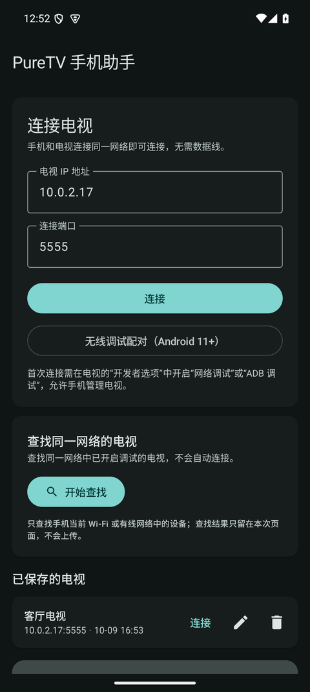</td>
    <td width="50%" valign="top">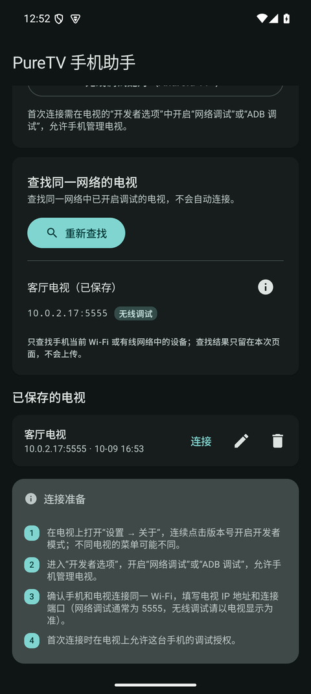</td>
  </tr>
  <tr>
    <td align="center"><sub>首页：连接状态、查找电视、已保存设备与自定义名称</sub></td>
    <td align="center"><sub>查找结果：已保存设备显示自定义名称，不重复显示连接按钮</sub></td>
  </tr>
  <tr>
    <td width="50%" valign="top">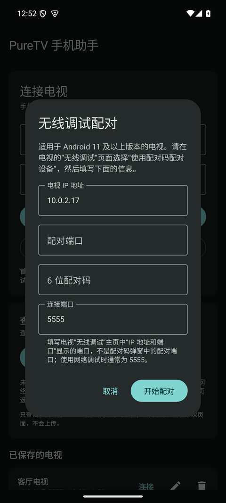</td>
    <td width="50%" valign="top">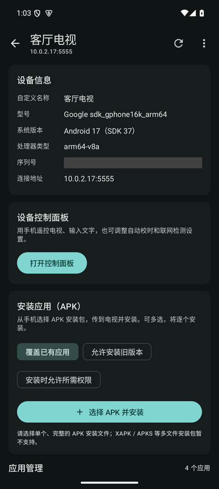</td>
  </tr>
  <tr>
    <td align="center"><sub>无线调试配对：预填地址与端口，仍需 TV 显示的配对码</sub></td>
    <td align="center"><sub>设备概览：设备信息、控制面板入口与 APK 安装</sub></td>
  </tr>
  <tr>
    <td width="50%" valign="top">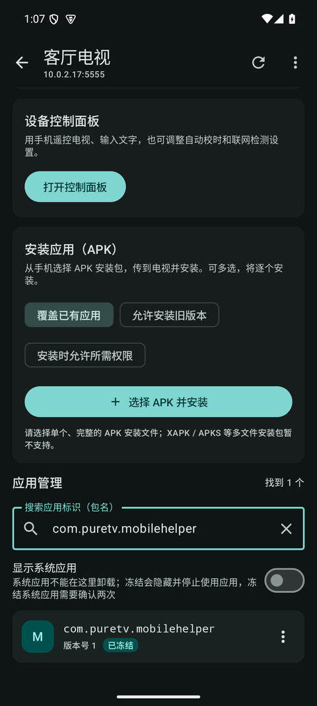</td>
    <td width="50%" valign="top">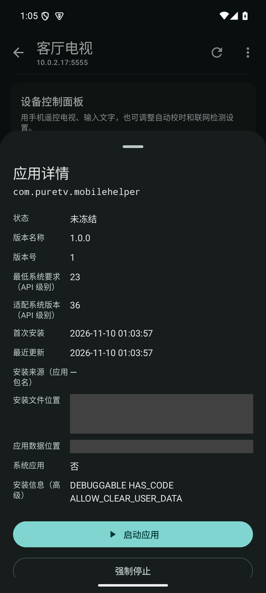</td>
  </tr>
  <tr>
    <td align="center"><sub>应用列表：第三方应用、版本号与“已冻结”标记</sub></td>
    <td align="center"><sub>应用详情：版本、路径、冻结/解冻、卸载</sub></td>
  </tr>
  <tr>
    <td width="50%" valign="top">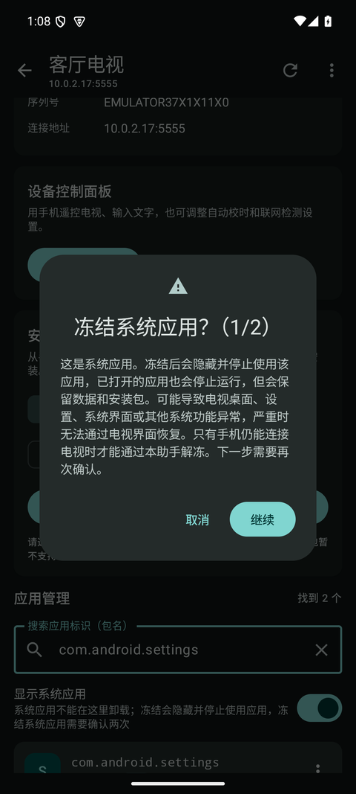</td>
    <td width="50%" valign="top">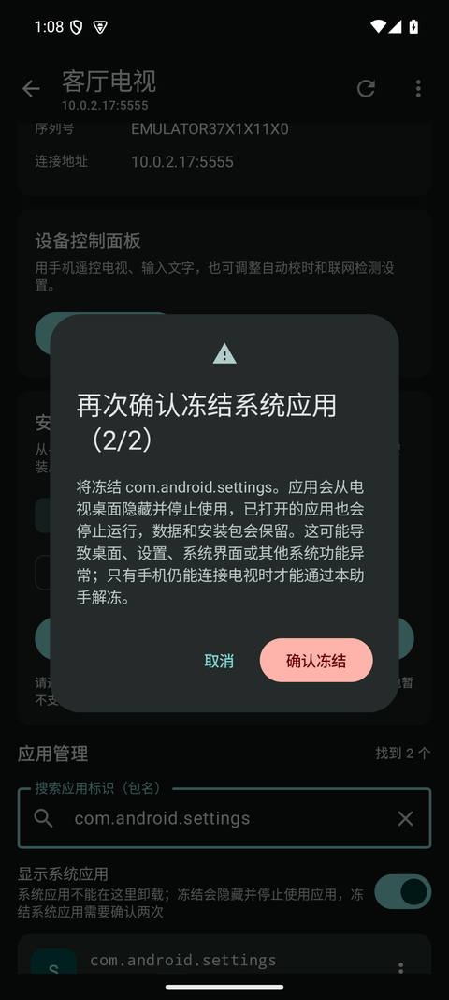</td>
  </tr>
  <tr>
    <td align="center"><sub>系统应用冻结二次确认（1/2）：风险提示</sub></td>
    <td align="center"><sub>系统应用冻结二次确认（2/2）：最终确认</sub></td>
  </tr>
  <tr>
    <td width="50%" valign="top">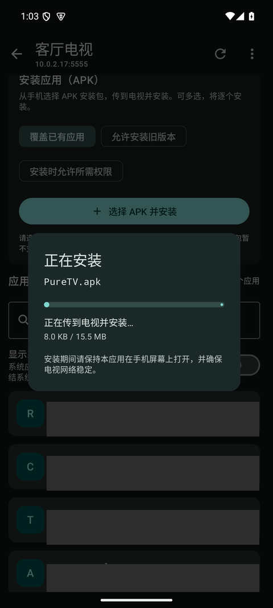</td>
    <td width="50%" valign="top">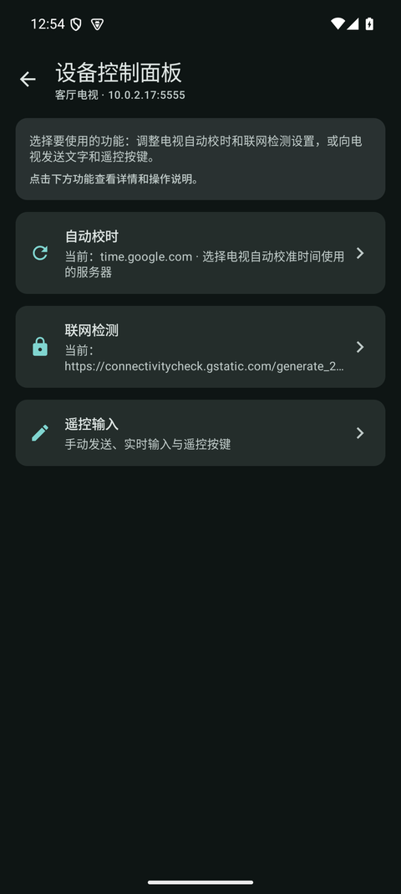</td>
  </tr>
  <tr>
    <td align="center"><sub>安装应用：安装包复制、传送及安装进度</sub></td>
    <td align="center"><sub>设备控制面板：自动校时、联网检测与遥控输入</sub></td>
  </tr>
  <tr>
    <td width="50%" valign="top">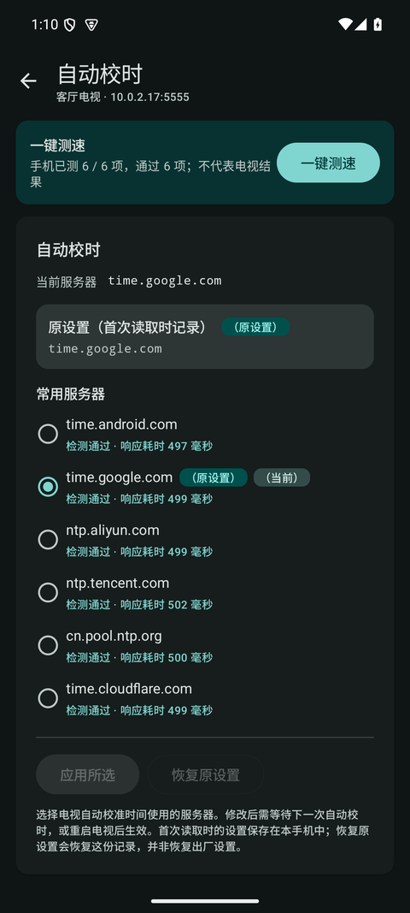</td>
    <td width="50%" valign="top">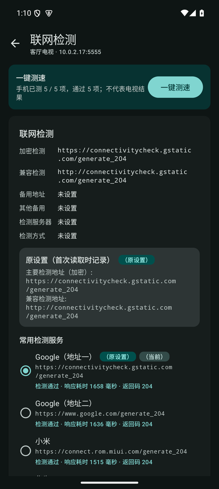</td>
  </tr>
  <tr>
    <td align="center"><sub>自动校时：可选服务器、原设置与测速结果</sub></td>
    <td align="center"><sub>联网检测：检测地址、原设置与测速结果</sub></td>
  </tr>
  <tr>
    <td width="50%" valign="top">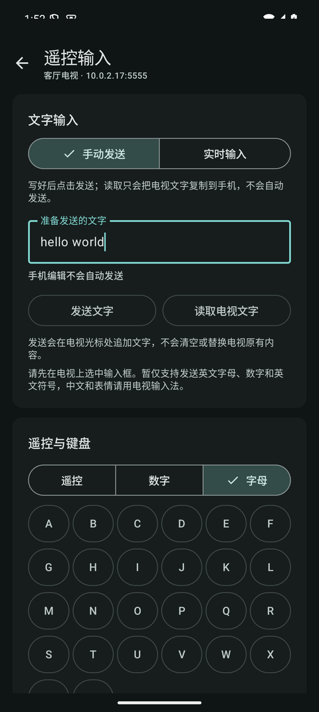</td>
    <td width="50%" valign="top">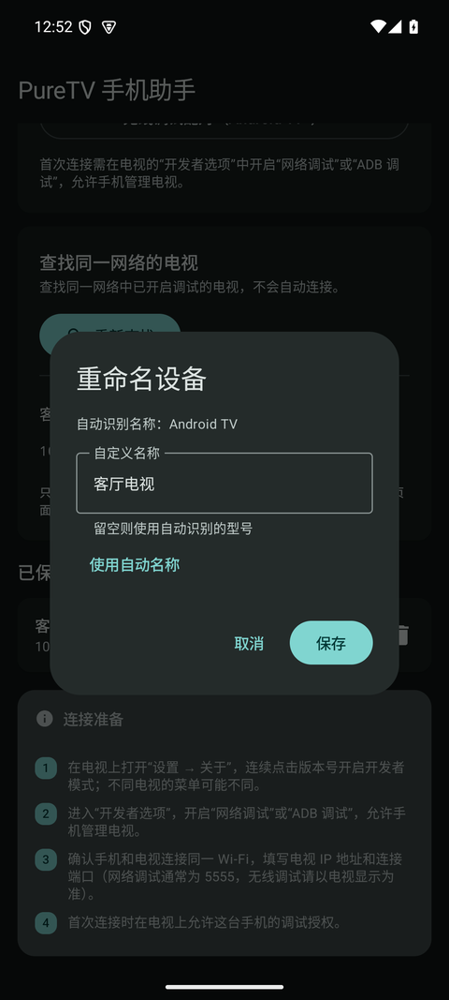</td>
  </tr>
  <tr>
    <td align="center"><sub>遥控输入：手动/实时输入，遥控、数字和字母面板</sub></td>
    <td align="center"><sub>重命名设备：自定义名称或恢复自动识别名称</sub></td>
  </tr>
</table>

## 环境要求

| 项目 | 要求 |
| --- | --- |
| 手机 | Android 6.0（API 23）及以上；无线配对需要 Android 9+ |
| 电视 | 已开启网络调试 / ADB 调试，且与手机连接同一个路由器 |
| 构建 | JDK 25（单元测试需 Java 25）、Android SDK Platform 37、Build Tools 36+ |

> 在电视“开发者选项”中查找“网络调试”或“ADB 调试”。仅开启“USB 调试”不一定能通过网络
> 连接；部分电视重启后需要重新开启。连接端口以电视显示的为准，常见为 `5555`。使用 Android 11
> 及以上版本“无线调试”时，配对端口与连接端口通常不同，请分别填写电视页面显示的数字。

## 构建

```bash
cd PureTVMobileHelper
./gradlew :app:assembleDebug
./gradlew :app:assembleRelease
```

产物：

- Debug：`app/build/outputs/apk/debug/app-debug.apk`
- Release：本机存在 `signing/signing.properties` 时为已签名的 `app/build/outputs/apk/release/app-release.apk`，
  否则为未签名的 `app-release-unsigned.apk`。

签名密钥与 `signing.properties` 一起放在 `signing/` 目录（含 `puretv-release.jks`），只保存在本机、
整个目录都被 Git 忽略；备份该目录即可。更换签名后需卸载旧版再安装。

安装到手机：

```bash
adb install -r app/build/outputs/apk/debug/app-debug.apk
```

本地读回解析回归测试：`./gradlew :app:testDebugUnitTest`（JUnit 4.13.2）。

## 自动发布

`.github/workflows/release.yml` 在推送到 `release` 分支、或从该分支手动触发时，运行单元测试、构建
签名版 Release APK，并以 `v<版本名>-b<版本号>` 创建预发布 Release（重跑附加 `-a<次数>`）。版本号使用
GitHub Actions 的 `run_number` 递增，可通过 `-PappVersionCode=...` 在本地复现。

在仓库 Settings → Secrets and variables → Actions 添加（建议放入 `release` Environment）：

| Secret | 内容 |
|---|---|
| `RELEASE_KEYSTORE_BASE64` | `base64 -i signing/puretv-release.jks` 的输出 |
| `RELEASE_STORE_PASSWORD` | keystore 密码 |
| `RELEASE_KEY_ALIAS` | `puretv` |
| `RELEASE_KEY_PASSWORD` | 密钥密码 |

签名材料只写入 runner 的临时目录，不进入日志或提交。该工作流不使用 `pull_request` 触发，
避免外部贡献者获取签名密钥。

任务只在 `release` 分支执行（`if: github.ref_name == 'release'`），其他分支或手动运行都会被跳过。
在 Settings → Environments 创建 `release` 环境，并设置：

- Deployment branches：仅 `release`；
- Required reviewers：至少勾选自己（发布前需人工批准）；
- 将四个 Secret 放进该 Environment，而不是仓库级。

再关闭 Settings → Actions → General 中的 fork 工作流选项（运行 fork 的 workflows、向 fork 工作流
发送写令牌）。这样只有拥有仓库写权限的人才能发起发布，且密钥只在受保护环境中解密。

## 使用

1. 手机与电视连接同一个 Wi-Fi 或路由器。
2. 在电视上开启开发者选项和网络调试，记下 IP 地址及连接端口。
3. 点击首页的“开始查找”，再选择要连接或配对的设备；不会自动连接。
   - “需要配对”会打开配对窗口，仍需填写电视显示的 6 位配对码；
   - 标为“已保存”的设备请从下方“已保存的电视”连接。名称优先使用自定义名称；
   - 地址相同不保证是原来的电视，请核对。名称旁的信息图标可查看说明，不会定时消失。
4. 也可手动填写 IP 地址与连接端口，点击“连接”。第一次连接时，请在电视上允许调试。
5. 点击已保存设备的铅笔图标，或设备页菜单中的重命名，设置最多 40 字的名称；留空恢复原名。
6. 进入设备页选择安装包，可多选并逐个安装；按需选择覆盖已有应用、允许安装旧版本和所需权限。
7. 应用菜单提供冻结和解冻。冻结会隐藏并停止使用应用，但应用和数据仍保留；系统应用确认两次。
8. 打开“设备控制面板”，选择“自动校时”“联网检测”或“遥控输入”。
   - 网络功能页可以选择服务器或检测地址，点击“应用”；“恢复原设置”会还原首次记录的值；
   - “一键测速”只测试当前功能的地址，由手机发起，不代表电视实际结果；修改设置可能需要电视
     重启或重新联网才生效；
   - 手动发送：编辑不自动发送，“发送文字”会在电视光标处追加整段文字，每点一次就追加一次；
     “读取电视文字”只复制到手机，不会自动发回电视；
   - 实时输入：每次从空白开始，只修改本轮文字，不读取、不清空电视原文。请让电视光标保持在
     文字末尾，期间不要在电视上改字或移动光标。切换模式不发送文字，手动草稿独立保留；
   - 数字和字母键盘与遥控方向键一样，点击后直接操作电视，不受上方手动发送/实时输入模式控制，
     也不会改动手机草稿。空格、删除、确定和大小写同样直接发给电视；
   - 若正在实时输入，按键会先等本轮文字传完并暂停，再执行，避免继续用旧位置改字。
     大小写是否生效由电视输入法处理；
   - 按键轻震跟随手机系统设置。文字暂仅支持英文字母、数字和英文符号，中文及表情请用电视输入法。

## 代码结构
```
app/src/main/java/com/puretv/mobilehelper/
├── PureTvHelperApp.kt          # 配置持久化 ADB 身份
├── MainActivity.kt
├── data/
│   ├── AdbRepository.kt        # Kadb 封装：连接/配对/包管理/冻结/流式安装
│   ├── LanDiscovery.kt         # mDNS 无线调试发现 + 私有 IPv4 5555 端口扫描
│   ├── NetworkControl.kt       # NTP / Captive Portal 设置模型与预设
│   ├── DeviceStore.kt          # 设备列表 + 每台设备的默认网络配置（唯一存储）
│   ├── FilePrivateKeyStore.kt  # ADB 私钥原子写入应用私有目录
│   ├── FriendlyError.kt        # ADB / 安装错误到中文提示的映射
│   ├── FocusedInputText.kt     # 避免把电视输入框的提示语误读为正文
│   ├── RemoteTextEdit.kt       # 实时输入变化范围与发送前字符校验
│   └── Models.kt
├── ui/
│   ├── AppViewModel.kt         # 连接、发现、应用列表、安装/冻结状态
│   ├── PureTvApp.kt            # 页面切换、配对/安装/冻结/卸载对话框
│   └── screens/
│       ├── HomeScreen.kt       # 连接、自动发现入口、已保存设备、配对
│       ├── DiscoveryCard.kt    # 发现结果列表与连接/配对操作
│       ├── DeviceControlScreen.kt # 设备控制面板：功能列表与页面路由
│       ├── ControlPanelCommon.kt # 功能注册表与共享组件
│       ├── NtpControlPage.kt     # NTP 功能页
│       ├── CaptivePortalControlPage.kt # Captive Portal 功能页
│       ├── RemoteInputControlPage.kt # 手动发送/实时输入与遥控按键
│       └── DeviceScreen.kt     # 设备信息、安装、应用列表、详情
└── res/                        # 主题、图标

docs/images/                    # README 界面预览截图
```

所有 ADB 操作都在 `Dispatchers.IO` 上执行，并通过 `Mutex` 串行化，避免多个 shell/sync
流同时占用同一连接。

## 第三方依赖

- [Kadb](https://github.com/flyfishxu/Kadb)（Apache-2.0）：ADB 协议、配对、流式安装。
- Bouncy Castle（MIT）：ADB 主机证书生成与解析。
- `spake2-java`（JitPack）：Android 11+ 无线调试配对；因此构建需要访问 JitPack。

## 数据存储

所有“设备相关”数据统一存储在应用私有 Preferences：

```text
/data/user/0/com.puretv.mobilehelper/shared_prefs/puretv_devices.xml
```

每台设备一条 JSON 记录：

```json
{
  "serial": "设备序列号（可能为空）",
  "host": "192.168.1.100",
  "port": 5555,
  "name": "自动识别的显示名称",
  "customName": "客厅电视",
  "lastConnectedAt": 1760000000000,
  "networkDefaults": {
    "ntp": "time.android.com",
    "http": "http://connectivitycheck.gstatic.com/generate_204",
    "https": "https://connectivitycheck.gstatic.com/generate_204",
    "fallback": "http://www.google.com/generate_204",
    "otherFallback": "http://connectivitycheck.gstatic.com/generate_204",
    "server": "connectivitycheck.gstatic.com",
    "mode": "1"
  }
}
```

- 删除已保存设备时，`networkDefaults` 随设备记录一起删除。
- 以后新增的设备级字段（能力、偏好、缓存标识等）都应加入这条记录，不要再新建设备 Preferences。
- ADB 主机私钥是安全凭据，单独保存在 `files/adb/adbkey`。

## 已知限制

- 目前只支持完整的单个 APK 文件；XAPK / APKS 等需要多个文件一起安装的格式暂不支持。
- 电视必须开放网络调试；部分厂商关闭了此功能，只能用 USB。系统应用不能在这里卸载。
- 冻结系统应用可能让电视桌面、设置或界面异常；只有电视仍能连接本工具，才能在这里恢复。
  请不要冻结不了解用途的系统应用。部分电视会限制冻结操作。
- 应用列表显示应用在系统中的标识（包名），不一定是电视桌面显示的名称。
- 无线配对需要手机 Android 9 及以上。查找不到时请检查是否在同一个路由器、是否使用访客网络，
  或电视是否使用了其他连接端口；也可以手动填写地址。
- “已保存”只表示 IP 地址和连接端口与保存记录相同。换网络或地址被其他设备使用时可能认错。
- 自动校时和联网检测使用 Android 的标准设置，部分电视可能不支持或需要重启才能生效。
  应用不会替你开启或关闭联网检测，只修改检测地址。
- 测速在手机上进行，不代表电视的实际网络结果；部分服务器可能无法测试。检测未通过时会显示
  失败或返回码，结果不保存、不上传。
- 手动发送只追加，不替换或清空电视原文；实时输入只管理本轮发送的文字，要求电视光标始终
  位于末尾，期间不要在电视上改字或移动光标。切换模式会结束本轮实时输入，但不删除已发送内容。
- 文字发送暂仅支持英文字母、数字和英文符号，不支持中文及表情；不支持的字符会在删除旧文字
  之前被拦截。其他输入错误会暂停实时输入，请核对电视内容后切换模式重新开始。
- 读取电视文字需要应用提供可核对的输入框信息。读到提示语、正文恰好与提示语相同，或无法
  核对输入框时，不覆盖手机草稿，也不会自动把它当作空白输入框。
- “原设置”是首次使用控制面板时记录的值，不是出厂默认值；只保存在这台手机的设备记录中。
- 所有设备相关数据（连接信息与 NTP/Captive Portal 默认基线）统一存储在 `DeviceStore` /
  `puretv_devices.xml`；不要为新的设备字段另建 Preferences 文件。
- 当前 `targetSdk` 为 36。若后续升到 37（Android 17），必须声明并在运行时申请
  `ACCESS_LOCAL_NETWORK`，否则系统会阻断局域网 mDNS/TCP 扫描和 ADB 连接。

## 安全说明

- 连接授权信息只保存在本机应用私有目录，不导出、不备份。
- 安装时只读取你在文件选择器中选中的安装包，不申请读取全部文件的权限。
- 不收集或上传数据；只连接用户选择的电视、查找同网设备，以及在点击测速后请求对应服务器。
  查找和测速结果只保留在本次使用中。
- 设备列表与 NTP/Captive Portal 默认基线统一保存在应用私有
  `shared_prefs/puretv_devices.xml`（每台设备一条 JSON 记录），不导出、不参与备份。
- ADB 私钥单独保存在 `files/adb/adbkey`，不与设备记录混存。
