# PureTV 手机助手

用 Android 手机通过同一局域网连接电视，安装和管理电视应用，也能遥控电视、输入文字，
以及调整自动校时和联网检测设置。不需要电脑或数据线。

## 下载与更新

- 最新版本：<https://github.com/JamesWDGu/PureTVMobileHelper/releases/latest>
- 支持 Obtainium：添加本仓库地址，选择 `PureTV-*.apk`。
- 应用会自动检查更新，也可在首页点击“检查更新”；下载完成后由系统安装器确认安装。

## 功能

- **查找与连接**：查找同网电视或手动填写地址；不会自动连接，首次连接需在电视上允许调试。
- **应用管理**：安装一个或多个 APK，支持覆盖、安装旧版本和授予所需权限；可启动、停止、
  查看详情、卸载，或冻结/解冻应用。
- **遥控输入**：手动发送或实时输入文字，也可读取电视当前文字；提供方向、确定、返回、主页、
  音量、翻页等按键，以及数字、字母键盘。
- **设备控制面板**：把 PureTV 商店安装到电视，调整自动校时与联网检测设置；原设置可一键恢复。
- **测速**：在手机上比较候选服务器或检测地址的响应，不代表电视的实际网络结果。
- **版本更新**：启动时自动检查，首页显示当前版本并支持手动检查。

## 界面预览

<table>
  <tr>
    <td width="50%" valign="top">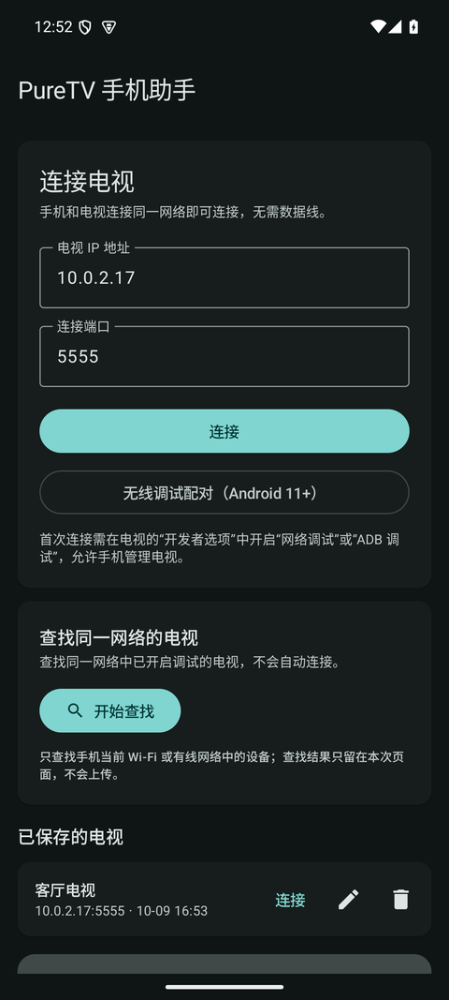</td>
    <td width="50%" valign="top">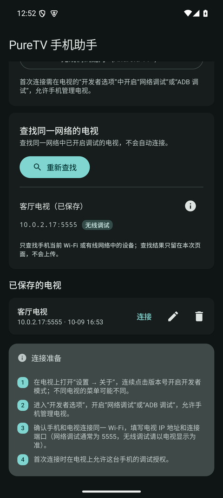</td>
  </tr>
  <tr>
    <td align="center"><sub>首页：连接状态、查找电视、已保存设备与自定义名称</sub></td>
    <td align="center"><sub>查找结果：已保存设备显示自定义名称，不重复显示连接按钮</sub></td>
  </tr>
  <tr>
    <td width="50%" valign="top">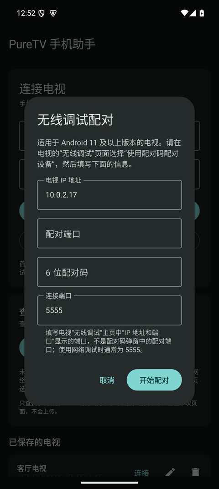</td>
    <td width="50%" valign="top">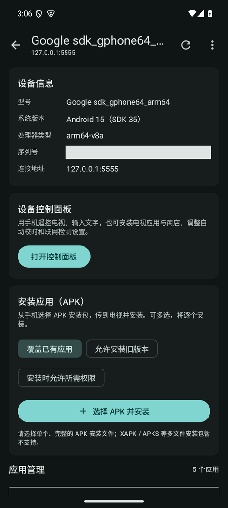</td>
  </tr>
  <tr>
    <td align="center"><sub>无线调试配对：预填地址与端口，仍需 TV 显示的配对码</sub></td>
    <td align="center"><sub>设备概览：设备信息、控制面板入口与 APK 安装</sub></td>
  </tr>
  <tr>
    <td width="50%" valign="top">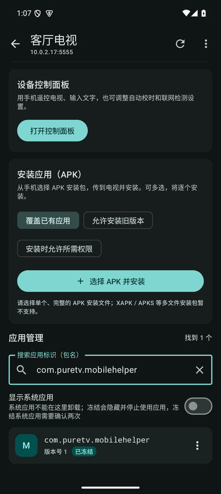</td>
    <td width="50%" valign="top">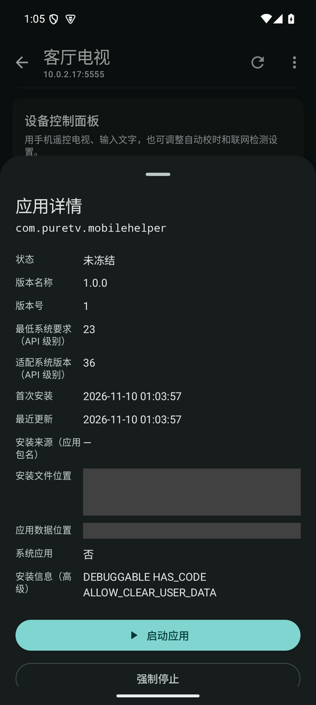</td>
  </tr>
  <tr>
    <td align="center"><sub>应用列表：第三方应用、版本号与“已冻结”标记</sub></td>
    <td align="center"><sub>应用详情：版本、路径、冻结/解冻、卸载</sub></td>
  </tr>
  <tr>
    <td width="50%" valign="top">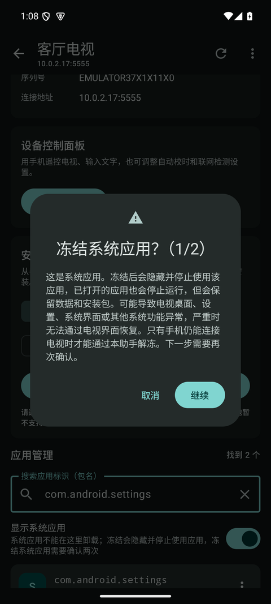</td>
    <td width="50%" valign="top">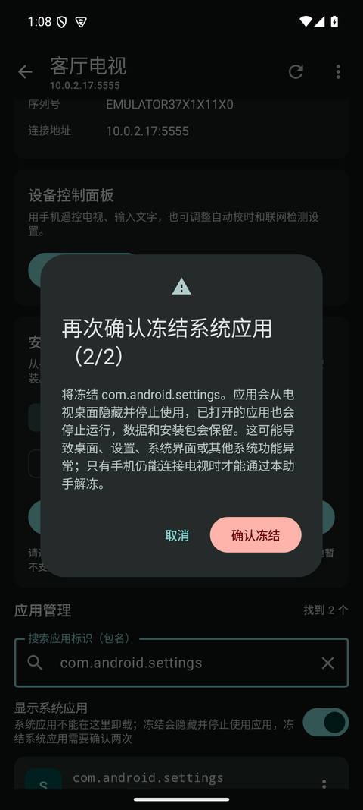</td>
  </tr>
  <tr>
    <td align="center"><sub>系统应用冻结二次确认（1/2）：风险提示</sub></td>
    <td align="center"><sub>系统应用冻结二次确认（2/2）：最终确认</sub></td>
  </tr>
  <tr>
    <td width="50%" valign="top">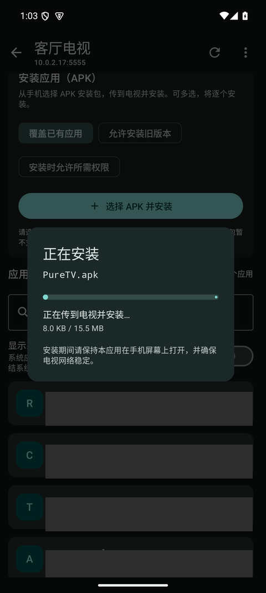</td>
    <td width="50%" valign="top">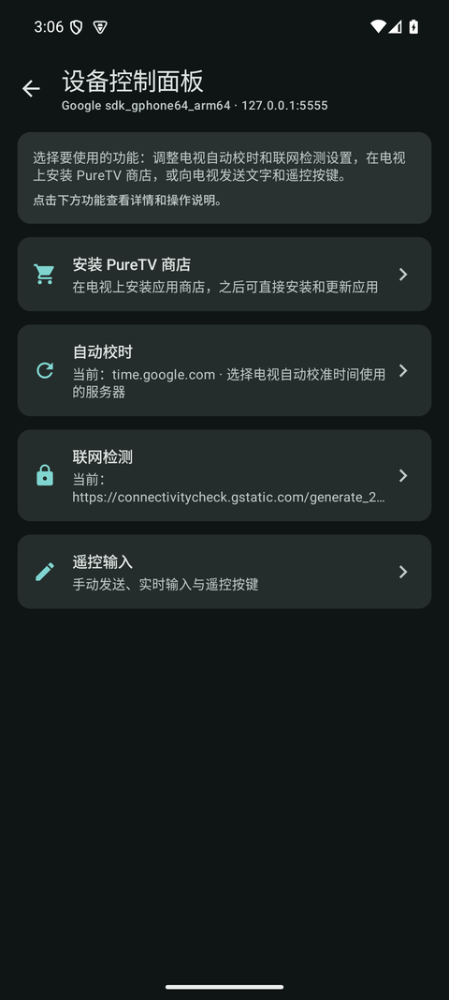</td>
  </tr>
  <tr>
    <td align="center"><sub>安装应用：安装包复制、传送及安装进度</sub></td>
    <td align="center"><sub>设备控制面板：安装 PureTV 商店、自动校时、联网检测与遥控输入</sub></td>
  </tr>
  <tr>
    <td width="50%" valign="top">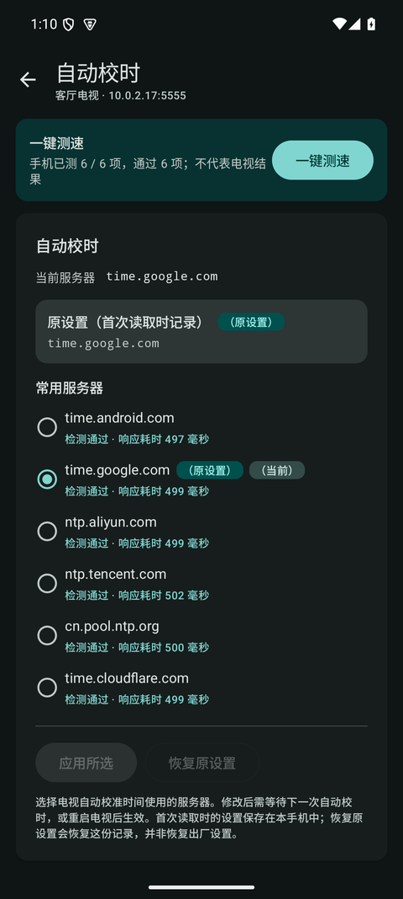</td>
    <td width="50%" valign="top">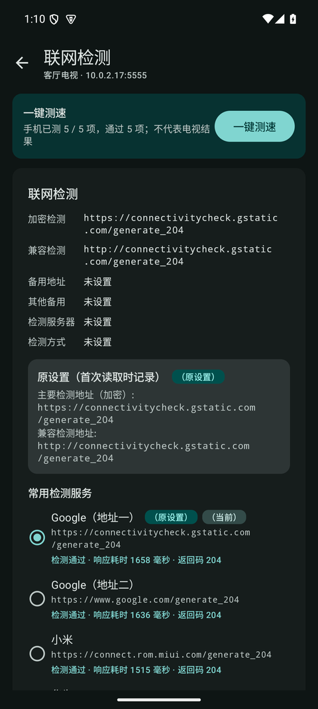</td>
  </tr>
  <tr>
    <td align="center"><sub>自动校时：可选服务器、原设置与测速结果</sub></td>
    <td align="center"><sub>联网检测：检测地址、原设置与测速结果</sub></td>
  </tr>
  <tr>
    <td width="50%" valign="top">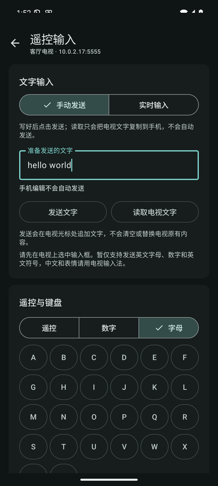</td>
    <td width="50%" valign="top">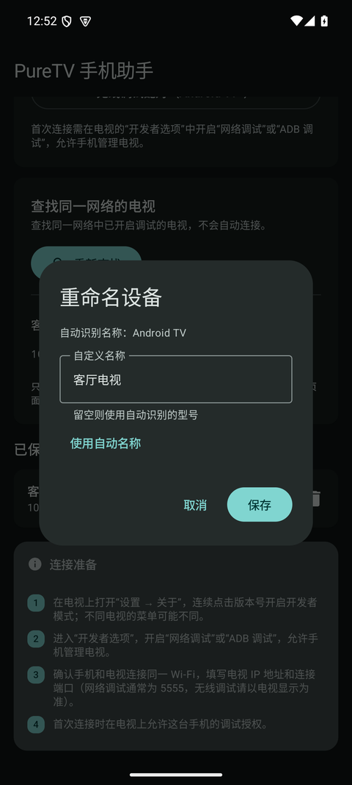</td>
  </tr>
  <tr>
    <td align="center"><sub>遥控输入：手动/实时输入，遥控、数字和字母面板</sub></td>
    <td align="center"><sub>重命名设备：自定义名称或恢复自动识别名称</sub></td>
  </tr>
  <tr>
    <td width="50%" valign="top">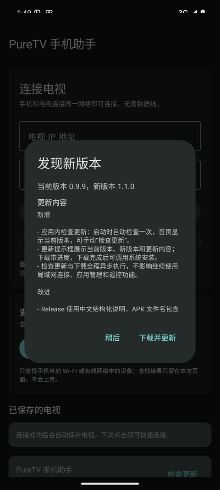</td>
    <td width="50%"></td>
  </tr>
  <tr>
    <td align="center"><sub>版本更新：当前/新版本、更新内容、下载进度与安装入口</sub></td>
    <td></td>
  </tr>
  <tr>
    <td width="50%" valign="top">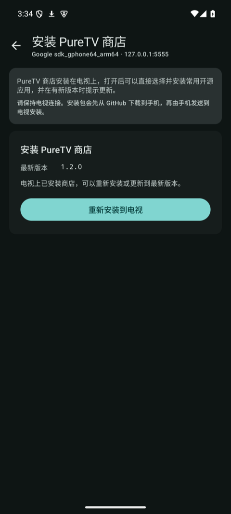</td>
    <td width="50%"></td>
  </tr>
  <tr>
    <td align="center"><sub>安装 PureTV 商店：获取最新版本并安装到电视</sub></td>
    <td></td>
  </tr>
</table>

## 环境要求

| 项目 | 要求 |
| --- | --- |
| 手机 | Android 6.0 及以上；无线配对需要 Android 9 及以上 |
| 电视 | 已开启“网络调试”或“ADB 调试”，与手机连接同一个路由器 |

在电视的“开发者选项”中开启调试。连接端口以电视显示为准，常见为 `5555`；使用无线调试时，
配对端口与连接端口通常不同。部分电视重启后需要重新开启调试。

## 使用

1. 手机与电视连接同一个 Wi-Fi 或路由器。
2. 点击“开始查找”，选择设备连接；标为“需要配对”的设备需填写电视显示的 6 位配对码。
   也可以手动填写 IP 地址和连接端口。
3. 首次连接时，在电视上允许这台手机调试。
4. 进入设备页后可安装 APK、查看应用列表；已保存的电视可重命名。
5. 冻结会隐藏并停止使用应用，但保留数据；系统应用冻结需要确认两次。
6. 在“设备控制面板”中安装 PureTV 商店、调整自动校时和联网检测，或使用遥控输入。
7. 安装商店后，在电视上打开 PureTV 商店，即可选择并安装或更新开源应用。
8. 首页底部显示当前版本，可手动检查更新；有新版本时按提示下载并安装。

## 已知限制

- 只支持完整、单一 APK；XAPK / APKS 等多文件安装包暂不支持。
- 电视必须开放网络调试；部分厂商限制该功能。系统应用不能在此卸载。
- 冻结系统应用可能导致电视界面异常，只有电视仍能连接本应用时才能恢复。
- 应用列表显示包名，不一定是电视桌面上的名称。
- 自动发现受访客网络、VLAN、AP 隔离和端口差异影响，可改用手动地址。
- 自动校时和联网检测使用 Android 标准设置，部分电视需重启或重新联网才生效。
- 测速在手机上进行，不代表电视的实际网络结果。
- 文字输入暂只支持英文、数字和英文符号；实时输入要求电视光标保持在本轮文字末尾。
- 检查更新和安装商店需要能访问 GitHub；GitHub 接口受限时会自动改用发布页信息，仍失败时
  会显示原因，可稍后重试。

## 隐私

- 不收集、不上传数据。仅在连接电视、用户主动查找、测速和检查更新时访问网络。
- ADB 授权密钥保存在应用私有目录，不导出、不参与备份。
- 安装应用更新由 Android 系统安装器确认，不会静默安装。

## 开发

```bash
./gradlew :app:assembleDebug
./gradlew :app:testDebugUnitTest
```

构建、发布、签名与数据存储等开发细节见 [AGENTS.md](AGENTS.md)。
